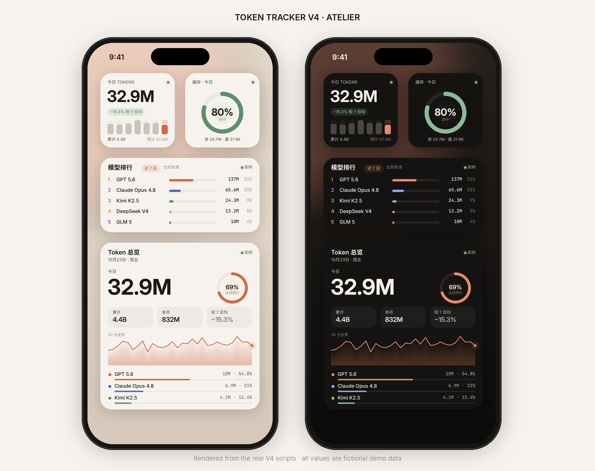
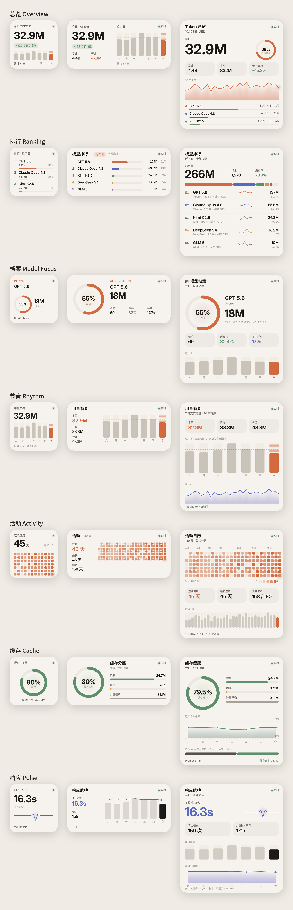
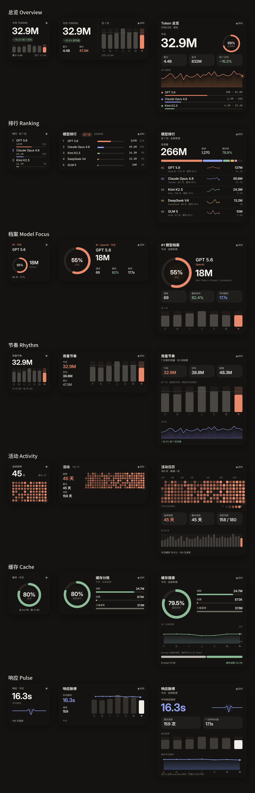

<p align="center"></p>

<h1 align="center">Token Tracker · V4 Atelier</h1>

<p align="center">
一套自托管的多来源 Token 用量后端，配一组为 iPhone 桌面认真设计过的 Scriptable 小组件。<br>
<sub>A self-hosted, multi-source token ledger with seven carefully designed iOS widgets.</sub>
</p>

<p align="center">


</p>

<p align="center"><sub>图中所有数字都来自 <code>tools/v4/demo_payload.json</code>，是用真实分析代码跑出的<b>虚构演示数据</b>，不代表任何真实用量。<br>Every value shown is fictional: synthetic events run through the real analytics.</sub></p>

---

## V4 · Atelier

V4 是一次彻底的视觉重做：
- **一张画布：**每个组件都画成一整张图（DrawContext 满幅绘制），排版、细线、圆环和图表都落在设计好的位置上。
- **三档尺寸：**7 个组件 × Small / Medium / Large，共 21 套独立布局。
- **亮暗双色：**亮色和暗色各有一套调色。

| | |
|---|---|
| **纸面与墨色** | 暖纸白 `#F6F3EE` / 深墨 `#141311`，正文墨色与三档灰阶；不用玻璃、不用大面积渐变。 |
| **一种主色** | 陶土橙 `#D2693F` 只用来标出「今天」和最重要的那个数。缓存用鼠尾草绿，请求与耗时用靛蓝，预测用琥珀，排名依次轮换。 |
| **大数字** | SF Pro Rounded 粗体做主数字，长数字自动缩小，不截断；SF Mono 做表格数字，列对得齐。 |
| **图形** | 圆角柱、细线面积图（纵向渐隐）、圆环进度、180 天活动日历；今天的数据会带一点柔光。 |
| **诚实的状态** | 实时 / 缓存 / 稍旧 / 离线都会写出来；空数据和错误也有专门的画面。 |

<p align="center"> </p>

### 七个组件

| 脚本 | 内容 | Widget Parameter |
|---|---|---|
| `TokenOverviewV4.js` | 今日用量、较 7 日均值、达成预计的圆环、30 天走势、Top 3 | — |
| `ModelRankingV4.js` | 模型排行、占比色条、每个模型的 7 日迷你曲线 | `7d,all` |
| `ModelFocusV4.js` | 单个模型的档案：占比圆环、Token、请求、缓存、耗时、7 日柱 | `1,today,all` |
| `UsageRhythmV4.js` | 7 日真实用量、日均虚线、今日预计斜纹、30 天轮廓 | — |
| `ActivityCacheV4.js` | 180 天活动日历、连续 / 最长 / 活跃天数 | — |
| `CacheHealthV4.js` | 缓存命中圆环、读取 / 创建 / 计量基数、7 日命中率 | `today,all` |
| `ResponsePulseV4.js` | 平均响应耗时、每日请求与耗时 | `7d,all` |

参数的格式是 `[排名,]周期,来源`。周期可选 `today` / `7d` / `month`，来源填 `all` 或 `backend/sources.json` 里的来源 ID，顺序随意。

### 安装

1. 从 App Store 安装 **Scriptable**。
2. 把 `scriptable/SetupTokenTrackerV4.js` 导入 Scriptable 并运行一次，填写 API 地址和 API Key。设置只保存在本机，V4 也会读取已有的 V3 / V2 设置。
3. 导入需要的 `*V4.js` 脚本，长按桌面添加 Scriptable 小组件，选择对应脚本即可。尺寸可以随意选。

V2 / V3 的脚本、接口和设置都原样保留，可以和 V4 同时使用。

---

## 后端

- 多中转 / 多来源合并统计，也可以单独筛选某个来源；按 `source + request_id` 幂等去重。
- 主 Token = `prompt_tokens + completion_tokens`；缓存读取与缓存创建单独统计，不计入主 Token。
- 请求数是 `request_count` 的总和；响应耗时只对正数 `use_time` 样本取算术平均，不虚构 P95 / P99。
- 提供今日、近 7 天、本月和全部历史的聚合，以及模型归一化与家族、180 天活动、连续天数和线性预测。
- SQLite 持久化，支持全量 / 增量同步、网络重试和进程锁。

```bash
git clone https://github.com/Hj714110-oss/ScriptableTokenTrackerV2.git
cd ScriptableTokenTrackerV2
cp backend/.env.example backend/.env
cp backend/sources.example.json backend/sources.json   # 填写来源与凭据环境变量名

cd deploy && docker compose up -d --build              # 或：直接用 Python 运行，见 docs/DEPLOYMENT.md
```

内置的 Source Client 面向 New API / One API 风格的 `/api/log/self` 接口（分页 `success + data.total + data.items`，用量日志 `type == 2`）。详细说明见 [部署文档](docs/DEPLOYMENT.md)。

### API

所有请求都带请求头 `X-N8N-API-KEY: <TOKEN_API_KEY>`。

| 路径 | 说明 |
|---|---|
| `/v3`、`/token-tracker/v3` | 完整分析数据（V3 与 V4 组件都使用这个入口） |
| `/v2`、`/token-tracker/v2` | 兼容别名 |
| `/`、`/token-tracker` | 旧组件的日汇总 |
| `/health`、`/token-tracker/health` | 健康状态 |

---

## 开发

```text
src/v4/core.js            V4 唯一的源码：设计令牌、绘图原语、七个视图 × 三个尺寸
tools/build_v4.py         由 core.js 生成七个独立的 scriptable/*V4.js（改 core，再构建）
tools/v4/demo_payload.py  用真实 analytics 跑合成事件，生成虚构演示数据
tools/v4/preview/         在 Chromium 里模拟 Scriptable 的 DrawContext，渲染真实脚本，并合成 README 图片
```

```bash
python3 tools/build_v4.py                    # 生成 V4 组件
python3 tools/v4/demo_payload.py             # 生成虚构演示数据
node tools/v4/preview/render.js              # 渲染 42 张预览（7 组件 × 3 尺寸 × 亮/暗，需要 playwright）
python3 tools/v4/preview/compose.py          # 合成 assets/v4 下的首页图和全景图
python3 verify.py                            # 发布前检查
```

预览图由真实脚本渲染，字体用 Inter / JetBrains Mono / Noto Sans CJK 替代 SF Pro 和苹方，所以和手机上的效果会有细微差别。

`verify.py` 和 CI 会检查以下几项：
- Python 语法与确定性聚合测试；
- 全部 Scriptable 脚本的语法；
- V4 组件与 `src/v4/core.js` 是否一致；
- 演示数据是否标为虚构；
- 代码和 Git 历史里是否出现私有地址或硬编码凭据。

## 安全

- 不要把 `.env`、`sources.json`、数据库，或 Scriptable 本地的设置和缓存文件提交到 Git。
- 公网部署时请在反向代理后启用 HTTPS，使用足够长的随机 API Key，并定期轮换中转凭据。
- 发现安全问题，请按 [SECURITY.md](SECURITY.md) 私下报告。

## 版本

| 版本 | 视觉 | 文件 |
|---|---|---|
| **V4 · Atelier** | 纸面、墨色和一种主色，每个组件画成一整张图 | `*V4.js` · [设计说明](DESIGN.md) · [V4 文档](docs/V4.md) |
| V3 · Pixel Edition | 云朵邮局像素风 | `*V3.js` · [V3 文档](docs/V3.md) |
| V2 | 初版五组件 | `*V2.js` |

## 来源说明

本项目最初受 [DaleXiao/ScriptableTokenWidgets](https://github.com/DaleXiao/ScriptableTokenWidgets) 启发，是一个独立实现，没有复制其源文件。感谢原作者公开分享 Scriptable Token 小组件的思路。

## License

[MIT](LICENSE)
