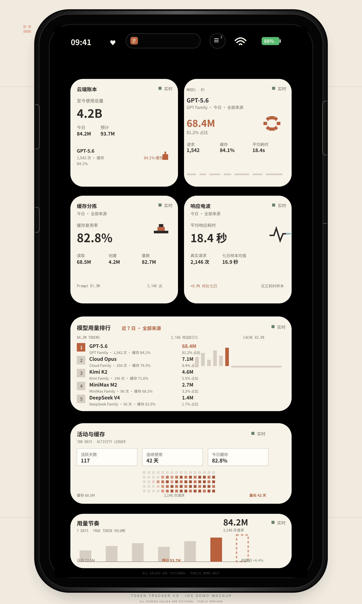

# Token Tracker V3 · Pixel Edition

一套自托管的多数据源 Token 用量分析后端，以及兼容 V2 的 Scriptable 小组件套件。

V3 使用 **Cloud Parcel Ledger（云朵邮局）**视觉系统：7 个组件、每个独立适配 Small / Medium / Large，共 21 套布局。V2 文件和数据契约继续保留，已有 V2 部署可以平滑共存。

> 下方是贴近实际 V3 部署的 iPhone 页面 mockup；屏幕中的所有数字、请求数、缓存率和模型用量均为重新编造的虚构演示数据，不代表维护者或用户的真实统计。

<p align="center">
  
</p>

<p align="center"><sub>Sanitized fictional demo · layout follows the real V3 widget family · no private runtime data</sub></p>


## 功能

- 多中转 / 多来源合并统计与来源独立筛选
- `source + request_id` 幂等去重
- 总 Token 口径为 `prompt_tokens + completion_tokens`
- 缓存读取与缓存创建 Token 单独统计，不重复计入总量
- 今日、近 7 天、本月、全部历史聚合
- 模型归一化、模型家族、Top 排行和趋势
- 180 日活动热力图、连续使用天数与线性预测
- V3 提供 7 个独立组件、21 套 Small / Medium / Large 布局
- 请求数使用事件中的 `request_count` 聚合，不把事件行数当作请求数
- 响应耗时只对正数 `use_time` 样本做算术平均，不虚构 P95 / P99
- SQLite 持久化、全量 / 增量同步、网络重试和进程锁
- 旧 API、V2 API、V3 别名和健康检查
- Scriptable 本地缓存、亮暗模式、V2 约 5 分钟 / V3 约 2 分钟刷新申请

## V2 五个组件（兼容保留）

| 文件 | 推荐尺寸 | 内容 |
|---|---|---|
| `TokenOverviewV2.js` | 小 / 中 / 大自适应 | 至今累计、今日、预测、Top 模型和 7 日节奏 |
| `ModelRankingV2.js` | 中号 | 周期与来源可筛选的模型 Top 3 |
| `ModelFocusV2.js` | 小号 | 指定排名模型的 Token、占比、缓存、耗时和趋势 |
| `UsageRhythmV2.js` | 中号 | 近 7 日用量、均值、峰值和预测 |
| `ActivityCacheV2.js` | 中号 | 180 日活动、连续天数与缓存效率 |

## V3 七个组件（Pixel Edition）

| 文件 | 推荐尺寸 | 内容 |
|---|---|---|
| `TokenOverviewV3.js` | 小 / 中 / 大 | 累计用量、今日、预测、Top 1 / Top 2 和七日节奏 |
| `ModelRankingV3.js` | 小 / 中 / 大 | 按周期与来源筛选的模型排行 |
| `ModelFocusV3.js` | 小 / 中 / 大 | 指定排行模型的 Token、占比、缓存和耗时 |
| `UsageRhythmV3.js` | 小 / 中 / 大 | 七日真实用量、均值、峰值和预测 |
| `ActivityCacheV3.js` | 小 / 中 / 大 | 180 日活动、连续使用与缓存上下文 |
| `CacheHealthV3.js` | 小 / 中 / 大 | 缓存读取、创建、计量基数和缓存率 |
| `ResponsePulseV3.js` | 小 / 中 / 大 | 请求数与正数 `use_time` 样本的算术平均 |

V3 的 `SetupTokenTrackerV3.js` 优先保存 `token-tracker-v3-settings.json`；组件兼容读取旧的 `token-tracker-v2-settings.json`，但任何设置文件都只存在于 Scriptable 本机文档目录。

## 快速开始

### 1. 部署后端

```bash
git clone https://github.com/Hj714110-oss/ScriptableTokenTrackerV2.git
cd ScriptableTokenTrackerV2
cp backend/.env.example backend/.env
cp backend/sources.example.json backend/sources.json
```

编辑 `backend/.env` 和 `backend/sources.json`，然后选择：

```bash
# Docker Compose
cd deploy
docker compose up -d --build

# 或直接运行
python3 -m venv .venv
. .venv/bin/activate
pip install -r backend/requirements.txt
set -a; . backend/.env; set +a
python3 backend/sync.py full
python3 backend/server.py
```

详细步骤见 [部署文档](docs/DEPLOYMENT.md)。

### 2. 配置 Scriptable

1. 从 App Store 安装 Scriptable。
2. 如使用 V2，运行 `SetupTokenTrackerV2.js` 并导入 V2 组件。
3. 如使用 V3，运行 `SetupTokenTrackerV3.js`，输入你的 HTTPS API 地址和 API Key。
4. 把需要的 V3 脚本添加为桌面小组件；每个脚本都独立适配 Small / Medium / Large。

配置只保存在 Scriptable 的本地文档目录，不写入组件源码。V2 与 V3 可以同时安装；V3 设置优先级高于 V2 设置。

### 3. 可选 Widget Parameter

`ModelRankingV2.js`：

```text
today,all
7d,relay_a
month,relay_b
```

格式为 `周期,来源ID`。周期支持 `today` / `7d` / `month`。

`ModelFocusV2.js`：

```text
1,today,all
2,7d,relay_a
1,month,relay_b
```

格式为 `排行序号,周期,来源ID`。

V3 的排行、档案、缓存和响应组件沿用同样的参数思路：

```text
ModelRankingV3.js   → 7d,all
ModelFocusV3.js     → 1,month,relay_a
CacheHealthV3.js    → today,all
ResponsePulseV3.js  → 7d,relay_b
```

周期支持 `today` / `7d` / `month`；来源使用 `all` 或 `backend/sources.json` 中的来源 ID。

内置 Source Client 面向常见 New API / One API 风格的 `/api/log/self` 日志接口：

- 分页响应：`success` + `data.total` + `data.items`
- 用量日志：`type == 2`
- 必需字段：`request_id`、`created_at`、`model_name`
- Token 字段：`prompt_tokens`、`completion_tokens`
- 可选字段：`cache_read_tokens`、`cache_creation_tokens`、`other.cache_tokens`、`use_time`
- 每条标准日志写入 `request_count = 1`；聚合时按该字段求和，响应耗时只计算正数 `use_time` 样本

每个来源都在 `backend/sources.json` 中声明 URL、认证类型和凭据环境变量名。示例见 `backend/sources.example.json`。

## API

所有接口使用请求头：

```http
X-N8N-API-KEY: <TOKEN_API_KEY>
```

| 路径 | 说明 |
|---|---|
| `/`、`/token-tracker` | 兼容旧组件的日汇总 |
| `/v2`、`/token-tracker/v2` | 完整分析响应 |
| `/v3`、`/token-tracker/v3` | V3 完整分析响应 |
| `/health`、`/token-tracker/health` | 健康状态 |

> `/v3` 与 `/token-tracker/v3` 是 V3 数据契约入口；`/v2` 与 `/token-tracker/v2` 保留为兼容别名。

## 设计

Cloud Parcel Ledger 使用暖云白、炭黑、陶土橙和低饱和蓝绿，结合系统自带字体、像素角色与正交数据图形；实际运行时由 Scriptable 根据 Small / Medium / Large 独立排版。公开预览使用贴近真实 V3 的 iPhone 页面 mockup，但其中所有数据均为虚构演示。

## 测试

```bash
python3 verify.py
```

CI 会检查：

- Python 语法与确定性聚合测试
- 14 个 Scriptable 脚本语法
- 私有地址和硬编码凭据
- 必需文档与部署文件

## 安全

- 不要把 `.env`、`sources.json`、数据库或 Scriptable 本地设置文件提交到 Git。
- 公网部署应在反向代理后启用 HTTPS。
- 使用长随机 API Key，并定期轮换中转访问凭据。
- 安全问题请按 [SECURITY.md](SECURITY.md) 私下报告。

## 来源说明

本项目是在分析 Token 用量组件这一问题空间后形成的独立 V2 实现。产品方向最初受到 [DaleXiao/ScriptableTokenWidgets](https://github.com/DaleXiao/ScriptableTokenWidgets) 启发；本仓库没有复制其源文件。感谢原作者公开展示 Scriptable Token 小组件的思路。

## License

[MIT](LICENSE)
