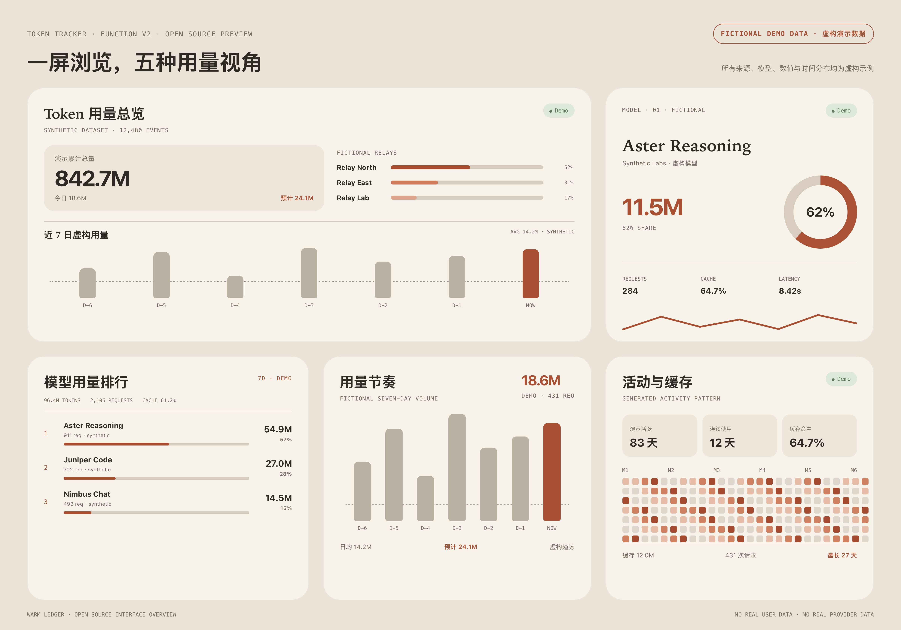

# Token Tracker V2

一套自托管的多数据源 Token 用量分析后端，以及 5 个适用于 iOS [Scriptable](https://scriptable.app/) 的桌面小组件。

> 下方预览中的来源、模型、数值和时间分布均为完全虚构的演示数据，不包含维护者或用户的真实统计。

<p align="center">
  
</p>


## 功能

- 多中转 / 多来源合并统计与来源独立筛选
- `source + request_id` 幂等去重
- 总 Token 口径为 `prompt_tokens + completion_tokens`
- 缓存读取与缓存创建 Token 单独统计，不重复计入总量
- 今日、近 7 天、本月、全部历史聚合
- 模型归一化、模型家族、Top 排行和趋势
- 180 日活动热力图、连续使用天数与线性预测
- SQLite 持久化、全量 / 增量同步、网络重试和进程锁
- 旧 API、V2 API、V3 别名和健康检查
- Scriptable 本地缓存、亮暗模式、约 5 分钟刷新申请

## 五个组件

| 文件 | 推荐尺寸 | 内容 |
|---|---|---|
| `TokenOverviewV2.js` | 小 / 中 / 大自适应 | 至今累计、今日、预测、Top 模型和 7 日节奏 |
| `ModelRankingV2.js` | 中号 | 周期与来源可筛选的模型 Top 3 |
| `ModelFocusV2.js` | 小号 | 指定排名模型的 Token、占比、缓存、耗时和趋势 |
| `UsageRhythmV2.js` | 中号 | 近 7 日用量、均值、峰值和预测 |
| `ActivityCacheV2.js` | 中号 | 180 日活动、连续天数与缓存效率 |

## 快速开始

### 1. 部署后端

```bash
git clone https://github.com/Hj714110-oss/ScriptableTokenTrackerV2.git
cd ScriptableTokenTrackerV2
cp backend/.env.example backend/.env
cp backend/sources.example.json backend/sources.json
```

编辑 `backend/.env` 和 `backend/sources.json`，然后选择：

```bash
# Docker Compose
cd deploy
docker compose up -d --build

# 或直接运行
python3 -m venv .venv
. .venv/bin/activate
pip install -r backend/requirements.txt
set -a; . backend/.env; set +a
python3 backend/sync.py full
python3 backend/server.py
```

详细步骤见 [部署文档](docs/DEPLOYMENT.md)。

### 2. 配置 Scriptable

1. 从 App Store 安装 Scriptable。
2. 把 `scriptable/` 下的 6 个 `.js` 文件导入 Scriptable。
3. 先运行 `SetupTokenTrackerV2.js`。
4. 输入你的 HTTPS V2 API 地址和 API Key。
5. 把其余 5 个脚本添加为桌面小组件。

配置只保存在 Scriptable 的本地文档目录，不写入组件源码。

### 3. 可选 Widget Parameter

`ModelRankingV2.js`：

```text
today,all
7d,relay_a
month,relay_b
```

格式为 `周期,来源ID`。周期支持 `today` / `7d` / `month`。

`ModelFocusV2.js`：

```text
1,today,all
2,7d,relay_a
1,month,relay_b
```

格式为 `排行序号,周期,来源ID`。

## 数据源契约

内置 Source Client 面向常见 New API / One API 风格的 `/api/log/self` 日志接口：

- 分页响应：`success` + `data.total` + `data.items`
- 用量日志：`type == 2`
- 必需字段：`request_id`、`created_at`、`model_name`
- Token 字段：`prompt_tokens`、`completion_tokens`
- 可选字段：`cache_read_tokens`、`cache_creation_tokens`、`other.cache_tokens`

每个来源都在 `backend/sources.json` 中声明 URL、认证类型和凭据环境变量名。示例见 `backend/sources.example.json`。

## API

所有接口使用请求头：

```http
X-N8N-API-KEY: <TOKEN_API_KEY>
```

| 路径 | 说明 |
|---|---|
| `/`、`/token-tracker` | 兼容旧组件的日汇总 |
| `/v2`、`/token-tracker/v2` | 完整分析响应 |
| `/v3`、`/token-tracker/v3` | V2 后续数据契约别名 |
| `/health`、`/token-tracker/health` | 健康状态 |

> 项目名称沿用 V2。响应中的 `version: 3` 表示 V2 数据契约的后续演进，并非另一套产品。

## 设计

Warm Ledger 使用暖纸、炭黑和陶土色，基于系统自带 New York / Avenir Next / Menlo 字体，不加载外部资源。公开预览只使用完全虚构的演示数据，不包含维护者或用户的真实统计。

## 测试

```bash
python3 verify.py
```

CI 会检查：

- Python 语法与确定性聚合测试
- 6 个 Scriptable 脚本语法
- 私有地址和硬编码凭据
- 必需文档与部署文件

## 安全

- 不要把 `.env`、`sources.json`、数据库或 Scriptable 本地设置文件提交到 Git。
- 公网部署应在反向代理后启用 HTTPS。
- 使用长随机 API Key，并定期轮换中转访问凭据。
- 安全问题请按 [SECURITY.md](SECURITY.md) 私下报告。

## 来源说明

本项目是在分析 Token 用量组件这一问题空间后形成的独立 V2 实现。产品方向最初受到 [DaleXiao/ScriptableTokenWidgets](https://github.com/DaleXiao/ScriptableTokenWidgets) 启发；本仓库没有复制其源文件。感谢原作者公开展示 Scriptable Token 小组件的思路。

## License

[MIT](LICENSE)
