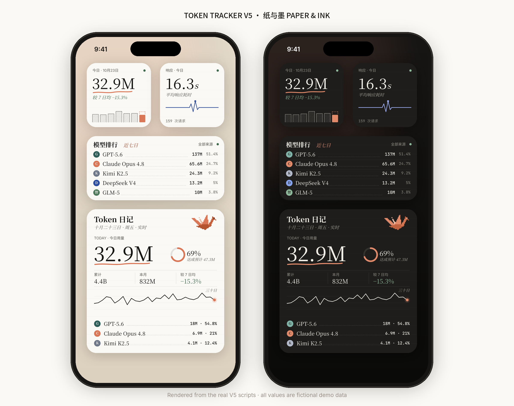
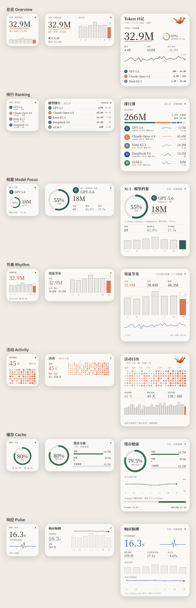
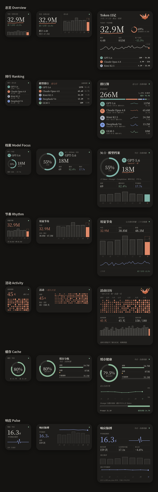

<p align="center"></p>

<h1 align="center">Token Tracker · V5 纸与墨</h1>

<p align="center">
一套自托管的多来源 Token 用量后端，配一组像账本一样的 Scriptable 小组件：纸、墨、衬线字，还有一只像素纸鹤。<br>
<sub>A self-hosted, multi-source token ledger with seven paper-and-ink iOS widgets.</sub>
</p>

<p align="center">


</p>

<p align="center"><sub>图中所有数字都来自 <code>tools/v4/demo_payload.json</code>：用真实分析代码跑出的<b>虚构演示数据</b>，不代表任何真实用量。<br>Every value shown is fictional: synthetic events run through the real analytics.</sub></p>

---

## V5 · 纸与墨 Paper & Ink

把小组件做成一本 Token 账本，每个组件都画成一整张图（DrawContext 满幅绘制）：
- **规模：**7 个组件，每个都有 Small / Medium / Large 三种尺寸，共 21 套独立排版。
- **配色：**白天是象牙纸，夜里是深色纸。

| | |
|---|---|
| **纸与墨** | 象牙纸 `#FAF9F5`、墨 `#141413`，纸上压着极淡的横格。陶土色 `#D97757` 只用来标出「今天」。缓存用鼠尾草绿，耗时用靛蓝，夜间各有一套颜色。 |
| **衬线字** | 大数字和英文用 Georgia，中文标题用宋体（设备上没有宋体时回落到系统字体）。小标签用系统无衬线；表格数字用等宽字，才对得齐。 |
| **笔迹** | 今天的数字下面有一笔手写下划线。过去的日子画成斜纹柱，今天是实色。预测用虚线框，日均用虚线并标一个「均」字。活动日历是一颗颗墨点，点越大用量越多。 |
| **账本排版** | 排行簿每一行用点线把模型名连到数值，像账本一样；Top 3 写成脚注；关键数字放在上下细线夹住的三栏条里。 |
| **纸鹤** | 原创的像素纸鹤，用陶土色的纸折成。实时同步时它在落笔，数据来自缓存或同步稍旧时它在打盹，连续使用追平纪录时它会展翅。 |
| **模型图标槽** | 每个模型前有一个圆形印章，默认显示模型家族的首字母。把你自己的图片放进 Scriptable 文件夹，就会自动替换成你的图标（见下）。 |

<p align="center"> </p>

### 七个组件

| 脚本 | 内容 | Widget Parameter |
|---|---|---|
| `TokenOverviewV5.js` | 「Token 日记」：今日用量和下划线、达成预计的圆环、三栏账、三十日笔线、Top 3 脚注、纸鹤 | — |
| `ModelRankingV5.js` | 排行簿：图标、点线、占比色条、每个模型的七日笔线 | `7d,all` |
| `ModelFocusV5.js` | 模型档案：占比圆环、图标、Token、请求 / 缓存 / 耗时、七日柱 | `1,today,all` |
| `UsageRhythmV5.js` | 七日斜纹柱、日均虚线、今日预计虚框、三十日轮廓 | — |
| `ActivityCacheV5.js` | 一百八十日墨点日历、连续 / 最长 / 活跃天数、近三十日柱 | — |
| `CacheHealthV5.js` | 缓存命中圆环、读取 / 创建 / 计量基数、七日命中率 | `today,all` |
| `ResponsePulseV5.js` | 平均响应耗时和心电图笔线、每日请求与耗时 | `7d,all` |

参数的格式是 `[排名,]周期,来源`，顺序随意。周期可选 `today` / `7d` / `month`，来源填 `all` 或 `backend/sources.json` 里的来源 ID。

### 给模型换上你自己的图标

在 iPhone 的「文件」App 里打开 **Scriptable** 文件夹（iCloud 或本机都可以），新建 `TokenTracker/icons/`，然后按模型家族命名图片：

```text
TokenTracker/icons/claude.png    openai.png    gemini.png    grok.png
                   deepseek.png  kimi.png      qwen.png      glm.png    minimax.png
```

- 支持 `png` 或 `jpg`。图片按正方形绘制，所以想要圆形图标，请准备带透明背景的圆形 PNG。
- 没有放图片的家族，会继续显示首字母印章。
- 图片只存在你的手机里；仓库和预览图只使用首字母印章，不包含任何公司的标志或角色形象。

### 安装

1. 从 App Store 安装 **Scriptable**。
2. 把 `scriptable/SetupTokenTrackerV5.js` 导入 Scriptable 并运行一次，填写 API 地址和 API Key。设置只保存在本机，V5 也会读取 V4 / V3 / V2 已有的设置。
3. 导入需要的 `*V5.js` 脚本，在桌面添加 Scriptable 小组件并选择对应的脚本。尺寸随意。

V2 / V3 / V4 的脚本、接口和设置都原样保留，可以和 V5 同时使用。

---

## 后端

- 多中转 / 多来源合并统计，也可以单独筛选某个来源；按 `source + request_id` 幂等去重。
- 主 Token = `prompt_tokens + completion_tokens`；缓存读取与缓存创建单独统计，不计入主 Token。
- 请求数是 `request_count` 的总和；响应耗时只对正数 `use_time` 样本取算术平均，不虚构 P95 / P99。
- 提供今日、近 7 天、本月和全部历史的聚合，以及模型归一化与家族、180 天活动、连续天数和线性预测。
- SQLite 持久化，支持全量 / 增量同步、网络重试和进程锁。

```bash
git clone https://github.com/Hj714110-oss/ScriptableTokenTrackerV2.git
cd ScriptableTokenTrackerV2
cp backend/.env.example backend/.env
cp backend/sources.example.json backend/sources.json   # 填写来源与凭据环境变量名

cd deploy && docker compose up -d --build              # 或：直接用 Python 运行，见 docs/DEPLOYMENT.md
```

内置的 Source Client 面向 New API / One API 风格的 `/api/log/self` 接口（分页 `success + data.total + data.items`，用量日志 `type == 2`）。详细说明见 [部署文档](docs/DEPLOYMENT.md)。

### API

所有请求都带请求头 `X-N8N-API-KEY: <TOKEN_API_KEY>`。

| 路径 | 说明 |
|---|---|
| `/v3`、`/token-tracker/v3` | 完整分析数据（V3、V4、V5 组件都使用这个入口） |
| `/v2`、`/token-tracker/v2` | 兼容别名 |
| `/`、`/token-tracker` | 旧组件的日汇总 |
| `/health`、`/token-tracker/health` | 健康状态 |

---

## 开发

```text
src/v5/core.js            V5 唯一的源码：纸与墨的设计令牌、笔迹原语、纸鹤、图标槽、七个视图 × 三个尺寸
tools/build_v5.py         由 core.js 生成七个独立的 scriptable/*V5.js（改 core，再构建）
src/v4/core.js · tools/build_v4.py   V4 · Atelier 的源码与构建
tools/v4/demo_payload.py  用真实 analytics 跑合成事件，生成虚构演示数据
tools/v4/preview/         在 Chromium 里模拟 Scriptable 的 DrawContext，渲染真实脚本，并合成 README 图片
```

```bash
python3 tools/build_v5.py                                # 生成 V5 组件（V4：build_v4.py）
python3 tools/v4/demo_payload.py                         # 生成虚构演示数据
TT_VERSION=V5 node tools/v4/preview/render.js            # 渲染 42 张预览（7 组件 × 3 尺寸 × 亮/暗，需要 playwright）
TT_VERSION=V5 python3 tools/v4/preview/compose.py        # 合成 assets/v5 下的首页图和全景图
python3 verify.py                            # 发布前检查
```

预览图由真实脚本渲染，但字体换成了替代字体：Noto Serif CJK 代替 Georgia 和宋体，Inter / JetBrains Mono 代替系统字体。所以和手机上的效果会有细微差别。

`verify.py` 和 CI 会检查以下几项：
- Python 语法与确定性聚合测试；
- 全部 Scriptable 脚本的语法；
- V4 / V5 组件与各自的 `src/*/core.js` 是否一致；
- 演示数据是否标为虚构；
- 代码和 Git 历史里是否出现私有地址或硬编码凭据。

## 安全

- 不要把 `.env`、`sources.json`、数据库，或 Scriptable 本地的设置、缓存和图标文件提交到 Git。
- 公网部署时请在反向代理后启用 HTTPS，使用足够长的随机 API Key，并定期轮换中转凭据。
- 发现安全问题，请按 [SECURITY.md](SECURITY.md) 私下报告。

## 版本

| 版本 | 视觉 | 文件 |
|---|---|---|
| **V5 · 纸与墨** | 账本、衬线字、笔迹、纸鹤和模型图标槽 | `*V5.js` · [设计说明](DESIGN.md) · [V5 文档](docs/V5.md) |
| V4 · Atelier | 暖纸面与圆体数字，偏 iOS 风格 | `*V4.js` · [V4 文档](docs/V4.md) · [图片](assets/v4/hero.png) |
| V3 · Pixel Edition | 云朵邮局像素风 | `*V3.js` · [V3 文档](docs/V3.md) |
| V2 | 初版五组件 | `*V2.js` |

## 来源说明

本项目最初受 [DaleXiao/ScriptableTokenWidgets](https://github.com/DaleXiao/ScriptableTokenWidgets) 启发，是一个独立实现，没有复制其源文件。感谢原作者公开分享 Scriptable Token 小组件的思路。

## License

[MIT](LICENSE)
